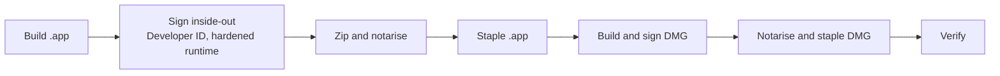

# Signing and notarising macOS apps

`macsign.py` signs, notarises, staples and packages a macOS app for distribution outside the App Store.
Works with any built `.app` (SwiftPM, Xcode, Tauri). See [notes](#using-it-in-your-project) for Xcode and Electron.

Needs a paid [Apple Developer Program](https://developer.apple.com/programs/) membership and Xcode. It is one file that uses the Python Xcode comes with and nothing else.



## Quick start

1. Try it with no credentials: `make test`
2. See every command that changes something in a release: `./macsign.py release path/to/MyApp.app --dry-run`
3. Get the [credentials](#credentials), then `./macsign.py setup` and `./macsign.py check`
4. Release the example app: `make release`
5. Release your own: `./macsign.py release path/to/MyApp.app`

The result is `dist/<name>-<version>.dmg`. The app is copied to `build/signing` first, the original is never changed.

- `setup`: store notarisation credentials in the Keychain
- `check`: fail if a release would not work
- `sign`: development sign (ad-hoc without a certificate), or Developer ID with `--release`
- `install`: development sign, then replace the copy in `/Applications`
- `notarise`: Developer ID sign, notarise and staple the app
- `dmg`: package a signed app into a notarised, stapled DMG
- `release`: `check`, `notarise`, `dmg` and `verify`
- `verify`: check signatures, hardened runtime, entitlements, Gatekeeper and staples
- `history`: list submissions to Apple, or show the log of one

Commands that change something are printed as they run. `--help` after any command lists its options.

## Credentials

You need two things, a certificate to sign with and an API key to notarise with.

### 1. Developer ID Application certificate

Only the team's Account Holder can create one, and each team gets [up to five](https://developer.apple.com/help/account/certificates/create-developer-id-certificates/).

In Xcode:

1. Settings > Accounts > add your Apple Account and select your team
2. Manage Certificates > + > Developer ID Application

Or without Xcode's UI:

1. Keychain Access > Certificate Assistant > Request a Certificate From a Certificate Authority, saved to disk
2. Upload it at [Certificates](https://developer.apple.com/account/resources/certificates/list) > + > Developer ID Application
3. Open the downloaded `.cer` to add it to the login keychain

Check it is installed with its private key:

```bash
security find-identity -v -p codesigning
```

Back it up: in Keychain Access, My Certificates, export it as a password protected `.p12` and keep that in a password manager.
Apple never has the private key.

An Apple Development certificate (same Xcode menu) is optional. Local builds signed with it keep their privacy permissions between rebuilds, which ad-hoc builds lose.

### 2. App Store Connect API key

1. Open [Users and Access > Integrations > App Store Connect API](https://appstoreconnect.apple.com/access/integrations/api), Team Keys tab (needs Admin)
2. On a new team, the Account Holder clicks Request Access first
3. Generate a key with the Developer role
4. Note the Issuer ID (a UUID above the list) and the Key ID
5. Download `AuthKey_<Key ID>.p8`. Apple allows this once

### 3. Store it

`./macsign.py setup` runs `notarytool store-credentials`, which asks for the key and IDs, checks them with Apple and saves them in the Keychain as the profile `apple-release`.
The profile is per developer, so every app can share it.

- Only `setup` asks for anything, every other command runs unattended.
- If the Keychain has an API key under the service `apple-release` (items `api-key`, `api-key-file` as base64, and `api-issuer`), that is used and `setup` has nothing to do. `KEYCHAIN_SERVICE` selects another service. The key is written to a private temporary file while notarising.
- Individual keys have no issuer. An Apple Account with an app-specific password works too, leave the key path empty when asked.
- Move the `.p8` to a password manager once stored. If it leaks, revoke it in App Store Connect.
- The first signing shows a Keychain prompt for `codesign`. Choose Always Allow.

The certificate needs no setup. The only Developer ID Application identity in the Keychain is used. If you have several, save one with `setup --identity <SHA-1 or name>`, or pass `--identity` (or `DEVELOPER_ID_APPLICATION`).
Development signing does the same with Apple Development, where `--identity -` (or `SIGN_IDENTITY=-`) forces ad-hoc.

For CI, an API key can be given as `--key`, `--key-id` and `--issuer`, or `APPLE_API_KEY_PATH`, `APPLE_API_KEY` and `APPLE_API_ISSUER`. These are used instead of the stored profile unless `--keychain-profile` is passed.

## Using it in your project

Copy `macsign.py` into it, or run a tagged version without copying:

```bash
uvx --from git+https://github.com/sammcj/apple-signing@<tag> macsign release path/to/MyApp.app
```

Build the app however you do now, then call it from your Makefile or CI:

```make
release: build
	./macsign.py release "$(APP)" --entitlements MyApp.entitlements
```

Entitlements:

- Start with none. With hardened runtime you add one only when something breaks, such as `com.apple.security.device.audio-input` for the microphone or `com.apple.security.cs.allow-jit` for a JIT.
- `__TEAM_ID__` in the file becomes your Team ID, for app groups and keychain access groups.
- Restricted entitlements (keychain access groups, iCloud, push) need a Developer ID [provisioning profile](https://developer.apple.com/account/resources/profiles/list). Pass it with `--profile file` (main app only). Without it the app is killed at launch.
- Entitlements apply to the main app only. Nested helpers keep the ones they were built with.

- macOS silently denies features whose entitlement is missing, so `verify --entitlements file` checks each key in the file is in the signed app.

Bundle contents:

- Scripts, data and resource-only bundles go in `Contents/Resources`. Anything in `Frameworks` or `Helpers` is treated as code.
- Copy Homebrew libraries into `Contents/Frameworks` and repoint them with `install_name_tool` (`-id` on the library, `-change` on what loads it). Do this before signing, it invalidates signatures. `verify` fails on leftover Homebrew paths.
- Sign once the bundle is final. Editing `Info.plist` afterwards breaks the signature.
- Xcode: pass an archived and exported app. Plain builds carry the `get-task-allow` debug entitlement, which Apple rejects (or build with `CODE_SIGN_INJECT_BASE_ENTITLEMENTS=NO`).
- Electron: sign with electron-builder or `@electron/osx-sign` first, so the helpers get their JIT entitlements. Signing again here keeps them.
- Tauri can sign and notarise the app itself when `APPLE_SIGNING_IDENTITY`, `APPLE_API_ISSUER`, `APPLE_API_KEY` and `APPLE_API_KEY_PATH` are set. To use the stored profile, leave the `APPLE_API_*` ones unset so it only signs, then release its output here. Signing again is fine.

## Troubleshooting

| Problem                                  | Fix                                                                                                                                                         |
| ---------------------------------------- | ----------------------------------------------------------------------------------------------------------------------------------------------------------- |
| Identity missing from `find-identity -v` | The private key is on another Mac (import its `.p12`), or the [Developer ID G2 intermediate](https://www.apple.com/certificateauthority/) is missing        |
| `several identities match`               | Save one with `setup --identity SHA-1`, or delete the old certificate                                                                             |
| `errSecInternalComponent`                | The keychain is locked, usual over SSH. Run `security unlock-keychain`                                                                                      |
| Notarisation `Invalid`                   | The log printed under it names each file. Usually an unsigned nested binary or a `get-task-allow` debug entitlement                                         |
| Notarisation stuck in progress           | A new team's first submissions can take hours or longer. `history` shows the state, `history ID` the log once done. Run `release` again once it clears                |
| Notarisation 401                         | Wrong issuer or key ID, or an issuer given for an Individual key. Run `setup` again                                                                         |
| Notarisation 403 mentioning an agreement | The Account Holder must accept the new terms at [developer.apple.com/account](https://developer.apple.com/account)                                          |
| Crashes only when signed                 | Hardened runtime. Check Console, then add the one entitlement it needs                                                                                      |
| Library refused, different Team IDs      | A nested library was not re-signed, or is loaded from outside the app                                                                                       |

## Not covered

- Auto-updates. [Sparkle](https://sparkle-project.org/documentation/) and [Tauri](https://v2.tauri.app/plugin/updater/) sign updates with their own key, separate from Apple's. Keep it in the Keychain too and back it up, losing it strands existing installs.
- Version bumps, changelogs and git tags. Check credentials before bumping and tag after `release` passes, so a failed release burns nothing.
- CI setup. Import the `.p12` into a temporary keychain and set the environment variables above.

Bare command line binaries can be signed and notarised in a zip, but not stapled. Gatekeeper checks those online.
