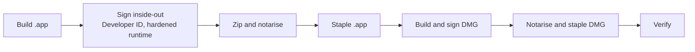

# Signing and notarising macOS apps

Scripts and a Makefile to sign, notarise, staple and package a macOS app for distribution outside the App Store.
Works with any built `.app` (SwiftPM, Xcode, Tauri). See [notes](#using-it-in-your-project) for Xcode and Electron.

Needs a paid [Apple Developer Program](https://developer.apple.com/programs/) membership and Xcode. `make lint` also needs `shellcheck`.



## Quick start

1. Try it with no credentials: `make test`
2. Get the [credentials](#credentials)
3. Store them: `make setup`
4. Confirm Apple accepts them: `make check`
5. Release the example app: `make dmg`
6. Release your own: `make dmg APP_SOURCE=path/to/MyApp.app`

The result is `dist/<name>-<version>.dmg`. Run `make` to list every target.

## Credentials

You need two things, a certificate to sign with and an API key to notarise with.

### 1. Developer ID Application certificate

Only the team's Account Holder can create one, and each team gets [up to five](https://developer.apple.com/help/account/certificates/create-developer-id-certificates/).

In Xcode:

1. Settings > Accounts > add your Apple Account and select your team
2. Manage Certificates > + > Developer ID Application

Or without Xcode's UI:

1. Keychain Access > Certificate Assistant > Request a Certificate From a Certificate Authority, saved to disk
2. Upload it at [Certificates](https://developer.apple.com/account/resources/certificates/list) > + > Developer ID Application
3. Open the downloaded `.cer` to add it to the login keychain

Check it is installed with its private key:

```bash
security find-identity -v -p codesigning
```

Back it up: in Keychain Access, My Certificates, export it as a password protected `.p12` and keep that in a password manager.
Apple never has the private key.

An Apple Development certificate (same Xcode menu) is optional. Local builds signed with it keep their privacy permissions between rebuilds, which ad-hoc builds lose.

### 2. App Store Connect API key

1. Open [Users and Access > Integrations > App Store Connect API](https://appstoreconnect.apple.com/access/integrations/api), Team Keys tab (needs Admin)
2. On a new team, the Account Holder clicks Request Access first
3. Generate a key with the Developer role
4. Note the Issuer ID (a UUID above the list) and the Key ID
5. Download `AuthKey_<Key ID>.p8`. Apple allows this once

Use a Team key. Individual keys need a different `notarytool` call, without the issuer.

### 3. Store them

`make setup` prompts for each and writes it to the login keychain under the service `apple-release`:

| Account                | Value                                              | Secret |
| ---------------------- | -------------------------------------------------- | ------ |
| `signing-identity`     | `Developer ID Application: Your Name (TEAMID1234)` | no     |
| `dev-signing-identity` | `Apple Development: ...` (optional)                | no     |
| `api-issuer`           | Issuer ID                                          | no     |
| `api-key`              | Key ID                                             | no     |
| `api-key-file`         | Contents of the `.p8`, base64                      | yes    |

The certificate's private key stays where Xcode or Keychain Access put it.

- Move the `.p8` to a password manager once stored. Notarising writes it to a private temporary file and removes it after.
- Anything running as you can read these items while the login keychain is unlocked. If the key leaks, revoke it in App Store Connect.
- Inspect one with `security find-generic-password -s apple-release -a api-key -w`.
- The first signing shows a Keychain prompt for `codesign`. Choose Always Allow.

Environment variables override the Keychain, for CI or a second team: `DEVELOPER_ID_APPLICATION`, `APPLE_API_ISSUER`, `APPLE_API_KEY`, `APPLE_API_KEY_PATH`.
`SIGN_IDENTITY` overrides the development identity. `KEYCHAIN_SERVICE=name` uses a different set of stored items.

## Using it in your project

1. Copy `scripts/` and the `Makefile`
2. Replace the `bundle` recipe with your build, leaving the app at `$(APP)`, and set `APP_NAME`
3. Set `ENTITLEMENTS` to your entitlements file, or leave it empty to keep the ones the app was built with

Staging happens in `build/signing`. `APP_SOURCE` is never changed.

Entitlements:

- Start with none. With hardened runtime you add one only when something breaks, such as `com.apple.security.device.audio-input` for the microphone or `com.apple.security.cs.allow-jit` for a JIT.
- `__TEAM_ID__` in the file becomes your Team ID, for app groups and keychain access groups.
- Restricted entitlements (keychain access groups, iCloud, push) need a Developer ID [provisioning profile](https://developer.apple.com/account/resources/profiles/list). Pass it with `PROFILE=file` (main app only). Without it the app is killed at launch.
- Entitlements apply to the main app only. Nested helpers keep the ones they were built with.

- macOS silently denies features whose entitlement is missing, so `make verify` checks each key in the file is in the signed app.

Bundle contents:

- Scripts, data and resource-only bundles go in `Contents/Resources`. Anything in `Frameworks` or `Helpers` is treated as code.
- Copy Homebrew libraries into `Contents/Frameworks` and repoint them with `install_name_tool` (`-id` on the library, `-change` on what loads it). Do this before signing, it invalidates signatures. `make verify` fails on leftover Homebrew paths.
- Sign once the bundle is final. Editing `Info.plist` afterwards breaks the signature.
- Xcode: pass an archived and exported app. Plain builds carry the `get-task-allow` debug entitlement, which Apple rejects (or build with `CODE_SIGN_INJECT_BASE_ENTITLEMENTS=NO`).
- Electron: sign with electron-builder or `@electron/osx-sign` first, so the helpers get their JIT entitlements. Signing again here keeps them.
- Tauri can sign and notarise the app itself when `APPLE_SIGNING_IDENTITY`, `APPLE_API_ISSUER`, `APPLE_API_KEY` and `APPLE_API_KEY_PATH` are set. Passing its output as `APP_SOURCE` signs it again, which is fine.

## Troubleshooting

| Problem                                  | Fix                                                                                                                                                         |
| ---------------------------------------- | ----------------------------------------------------------------------------------------------------------------------------------------------------------- |
| Identity missing from `find-identity -v` | The private key is on another Mac (import its `.p12`), or the [Developer ID G2 intermediate](https://www.apple.com/certificateauthority/) is missing        |
| `ambiguous` identity                     | Two certificates share a name. Delete the old one, or use the SHA-1 from `find-identity` as the identity                                                    |
| `did not read back as entered`           | `security` prints non-ASCII values as hex. Use the SHA-1 as the identity                                                                                    |
| `errSecInternalComponent`                | The keychain is locked, usual over SSH. Run `security unlock-keychain`                                                                                      |
| Notarisation `Invalid`                   | The log printed under it names each file. Usually an unsigned nested binary or a `get-task-allow` debug entitlement                                         |
| Notarisation stuck in progress           | A new team's first submissions can take hours or longer. `make history` shows the state, `make history ID=...` the log. Run `make dmg` again once it clears |
| Notarisation 401                         | Wrong issuer or key ID, or an Individual key                                                                                                                |
| Notarisation 403 mentioning an agreement | The Account Holder must accept the new terms at [developer.apple.com/account](https://developer.apple.com/account)                                          |
| Crashes only when signed                 | Hardened runtime. Check Console, then add the one entitlement it needs                                                                                      |
| Library refused, different Team IDs      | A nested library was not re-signed, or is loaded from outside the app                                                                                       |

## Not covered

- Auto-updates. [Sparkle](https://sparkle-project.org/documentation/) and [Tauri](https://v2.tauri.app/plugin/updater/) sign updates with their own key, separate from Apple's. Keep it in the Keychain too and back it up, losing it strands existing installs.
- Version bumps, changelogs and git tags. Check credentials before bumping and tag after `make verify` passes, so a failed release burns nothing.
- CI setup. Import the `.p12` into a temporary keychain and set the environment variables above.

Bare command line binaries can be signed and notarised in a zip, but not stapled. Gatekeeper checks those online.
